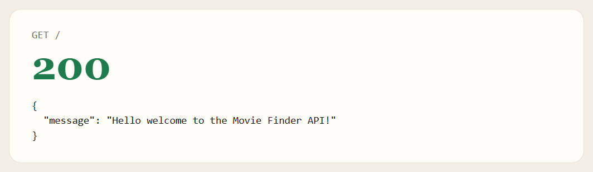
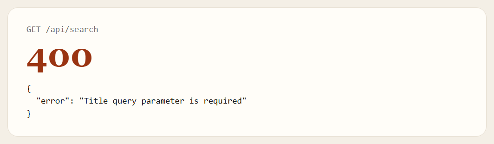
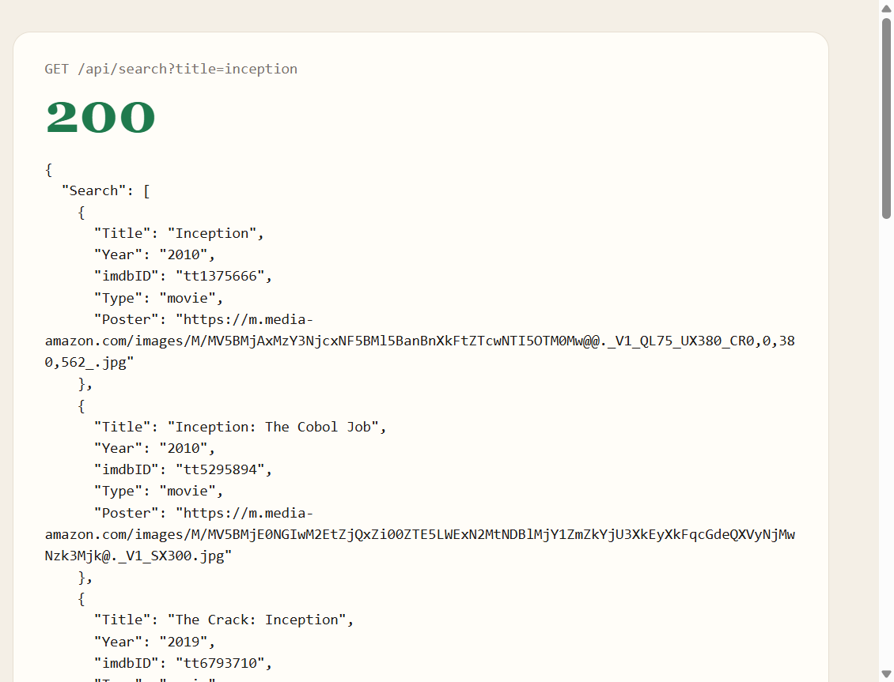
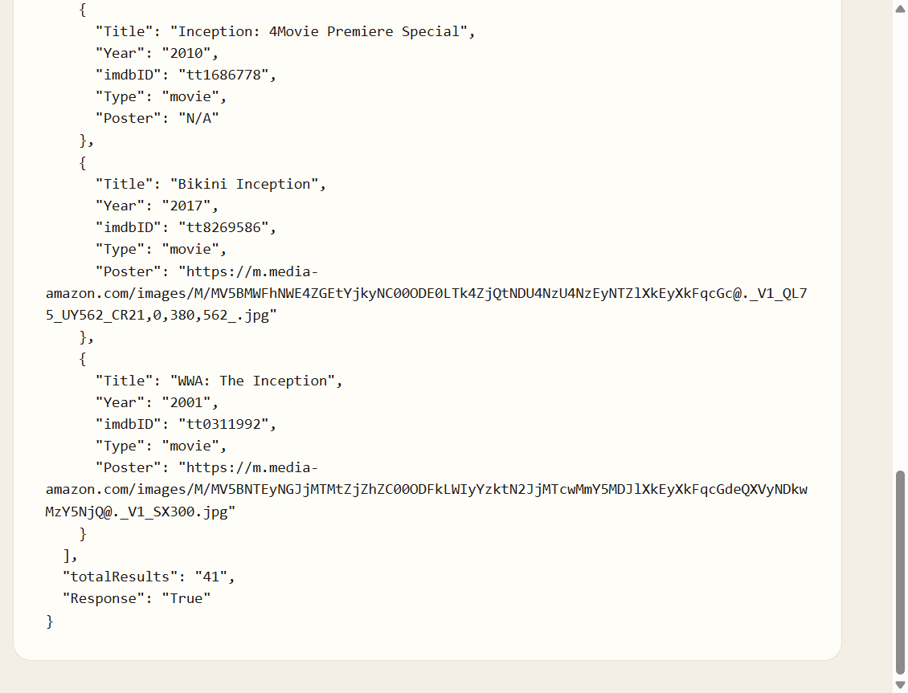
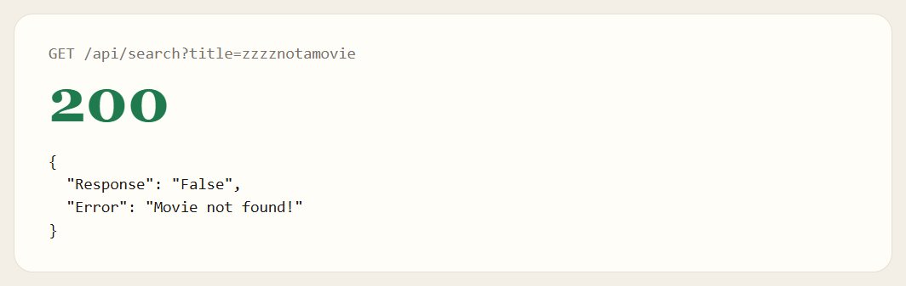
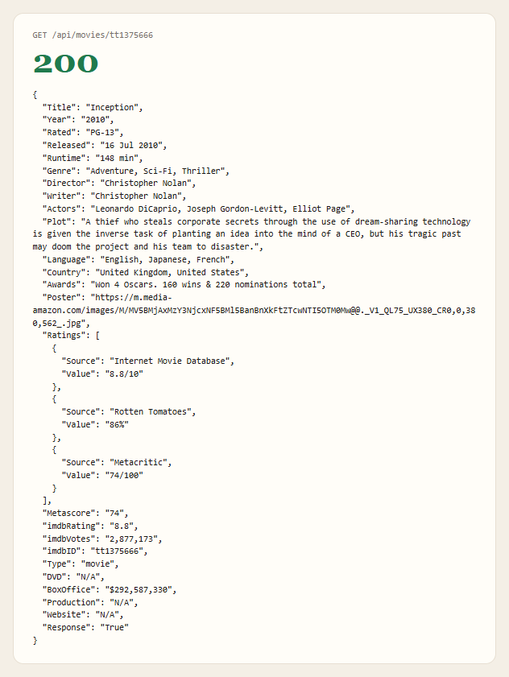
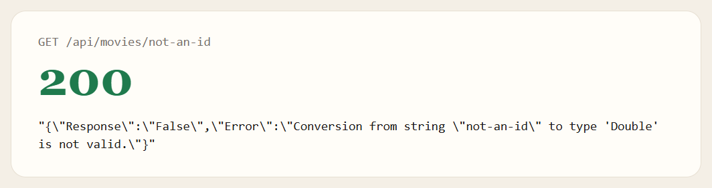
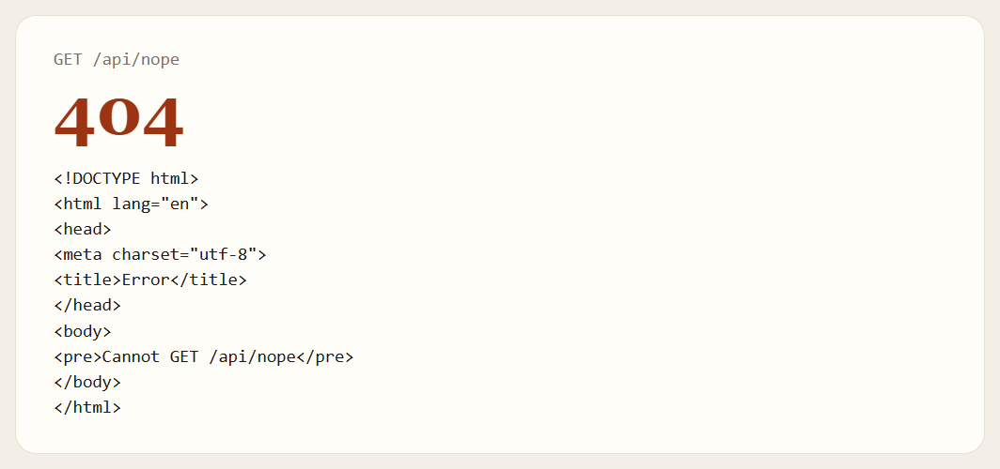

# SBA 12: Movie Finder API

An Express API. It does not serve an HTML page. It forwards movie lookups to OMDB.

## Description

It reads `PORT`, `OMDB_BASE_URL`, and `OMDB_API_KEY` from the environment. The responses below are from this run, which listened at http://localhost:3001.

`npm run dev` starts the same file with nodemon.

The search route reads `title` from the query string and sends it to OMDB as the `s` parameter, along with the API key. The route returns the OMDB body as it arrived.

With no `title`, or with an empty `title`, the route returns 400 before it calls OMDB.

`title=inception` returned 200. The body has 10 matches and `"totalResults": "41"`. That count is a string. The route does not send a page parameter, so this is the first page of matches.

| Title | Year | imdbID | Type |
| --- | --- | --- | --- |
| Inception | 2010 | tt1375666 | movie |
| Inception: The Cobol Job | 2010 | tt5295894 | movie |
| The Crack: Inception | 2019 | tt6793710 | movie |
| Inception: Jump Right Into the Action | 2010 | tt5295990 | movie |
| Inception: Motion Comics | 2010– | tt1790736 | series |
| Inception | 2014 | tt7321322 | movie |
| Madness Inception | 2022 | tt29258696 | movie |
| Inception: 4Movie Premiere Special | 2010 | tt1686778 | movie |
| Bikini Inception | 2017 | tt8269586 | movie |
| WWA: The Inception | 2001 | tt0311992 | movie |

Madness Inception and Inception: 4Movie Premiere Special have `"Poster": "N/A"`. The rest have a poster URL.

A title OMDB does not know still comes back as 200. The body says the search failed.

The details route sends the id to OMDB as the `i` parameter and returns that body. `tt1375666` is the 2010 Inception movie: PG-13, 148 min, directed by Christopher Nolan, rated 8.8 on IMDb, 86% on Rotten Tomatoes, and 74 on Metacritic. The box office in this response is `$292,587,330`.

`not-an-id` also returns 200. The body is a JSON string, not an object. The string is `{"Response":"False","Error":"Conversion from string "not-an-id" to type 'Double' is not valid."}`.

A path this server does not define returns Express's HTML 404. The visible line is `Cannot GET /api/nope`.

If the call to OMDB throws, search responds with 500 and `{ "error": "Failed to fetch search results" }`. Details responds with 500 and `{ "error": "Failed to fetch movie details" }`. The same failure is printed with `console.error`. This run did not hit that branch.

## Screenshots

### GET /



### GET /api/search









### GET /api/movies/:id





### Anything else



## Getting Started

### Dependencies

* Node.js and npm
* `PORT`, `OMDB_BASE_URL`, and `OMDB_API_KEY`

### Installing

```bash
npm install
```

### Executing program

```bash
npm start
```

This run listened at http://localhost:3001. `npm run dev` starts the same file with nodemon.

## Help

A search with no title returns 400 before OMDB is called. A title OMDB does not know still returns 200. `not-an-id` returns 200 and a JSON string. `GET /api/nope` is Express's HTML 404. This run did not hit the 500 branch.

## Authors

[Mamadou Moussa Balde](https://www.linkedin.com/in/2mb/)

## Version History

* Current local run
    * Listened at http://localhost:3001
    * Search for `inception` returned 10 of 41 matches
    * `tt1375666` returned the 2010 Inception movie

## License

This folder does not include a `LICENSE.md` file.

## Acknowledgments

* [OMDb](https://www.omdbapi.com/)
* [README template](https://gist.github.com/DomPizzie/7a5ff55ffa9081f2de27c315f5018afc)
